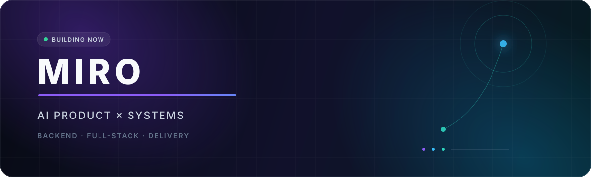

  

  
  

## Hi, I'm Miro 👋

I'm a full-stack engineer focused on turning **AI capabilities into reliable products**. My foundation is in Java and Go backend engineering; my work now spans product interaction, service architecture, data flows, model integration, containerization, and delivery automation.

我是一名专注于 **AI 产品工程化落地** 的全栈工程师。从 Java / Go 后端与复杂系统建设出发，持续将能力延伸到产品交互、前端实现、多模态模型集成和端到端交付。

### What I build

| Direction | Focus |
| --- | --- |
| **AI-native products** | AI Agent, tool calling, multimodal workflows, human-in-the-loop experiences |
| **Backend systems** | Service design, reliability, distributed workflows, APIs and data pipelines |
| **Full-stack delivery** | From product idea and prototype to deployment, observability and iteration |

### Engineering stack

  
  
  
  
  
  
  
  
  

### Selected work

<table>
  <tr>
    <td width="50%" valign="top">
      <h3><a href="https://github.com/hey-miro/ai-agent-demo">AI Agent Demo</a></h3>
      
A compact ReAct agent built in Go with tool calling, SSE streaming, and an offline mock mode.

      
<code>Go</code> <code>ReAct</code> <code>Tool Calling</code> <code>SSE</code>

    </td>
    <td width="50%" valign="top">
      <h3><a href="https://github.com/hey-miro/pomodoro-timer">Pomodoro Timer</a></h3>
      
A native macOS focus app combining landscape photography, classical quotes, and MIDI music.

      
<code>Java 17</code> <code>Swing</code> <code>macOS</code> <code>Zero Dependencies</code>

    </td>
  </tr>
</table>

### Currently exploring

- Building an end-to-end AI interview product with multimodal model integration.
- Applying Agent workflows to requirements, implementation, verification, and delivery.
- Exploring product opportunities where AI can create measurable business value.

### From the blog

I write about AI products, Vibe Coding, Java / Go, Docker, CI/CD, and distributed systems.

➡️ **[Visit Miro's personal blog](http://106.14.154.105/)**

---

  Build with clarity. Ship with evidence. Iterate with purpose.

